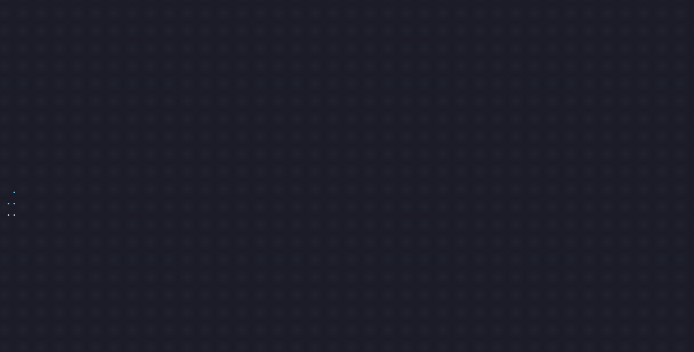

<div align="center">
  <!-- exact-text SVG wordmark (dot-outline mark + Tokyo Night palette), not a generated image -->
  <h1 style="margin:0;border:0;font-size:0;">
    
  </h1>

  <p><em>A Hyprland-native fetch utility — live session state, rice-aware details, terminal presentation.</em></p>

  <p>
    <a href="https://github.com/polarours/hyprfetch/actions"></a>
    <a href="https://github.com/polarours/hyprfetch/releases"></a>
    <a href="LICENSE"></a>
    <a href="https://www.rust-lang.org/"></a>
    
  </p>

  <p>
    <a href="#install"><strong>Install</strong></a> &middot;
    <a href="#quick-start"><strong>Quick Start</strong></a> &middot;
    <a href="#features"><strong>Features</strong></a> &middot;
    <a href="#configuration"><strong>Configuration</strong></a> &middot;
    <a href="#themes-and-logos"><strong>Themes &amp; Logos</strong></a> &middot;
    <a href="#development"><strong>Development</strong></a>
  </p>

  <!-- real screen recording of the reveal animation, captured from the binary in a PTY -->
  <a href="assets/screenshots/preview.png" title="Open the full-resolution still">
    
  </a>
  <p><sub>The reveal above is a real recording. Click for a full-resolution still.</sub></p>
</div>

> [!IMPORTANT]
> **hyprfetch 0.1.0 is an early, testing-stage release — not yet a stable version.**
> It is published on GitHub for feedback and real-world use, but the config format,
> module IDs and output layout may still change between releases. Please report bugs
> and rough edges through [GitHub Issues](https://github.com/polarours/hyprfetch/issues).
> Pin a specific version if you depend on its exact output.

---

## Why hyprfetch

- **Live compositor state, not just hardware.** Workspaces, clients, focused output, active window, monitors, keybinds and layer-shell surfaces are first-class rows, not an afterthought.
- **Made for rice screenshots.** It knows your GTK theme, icons, cursor, font, wallpaper backend and the daemons that make the desktop work, and draws them in a palette that matches.
- **Fast, focused and honest.** About 50 ms for the full render, 18 ms with `--fast`; unavailable modules stay out of the output instead of being faked. One binary, no runtime dependencies beyond the tools it probes.

## Features

### System

- OS, host, kernel, uptime, packages, shell, terminal, locale, date &amp; time
- CPU with realtime usage, GPU with VRAM and utilization, memory, swap, disk with selectable mount points, battery, temperature
- Network interface with IP, WiFi SSID, signal and link speed; PipeWire/PulseAudio sink with volume; MPRIS media players

### Hyprland session

- Compositor version, health summary (sockets, wallpaper, bar, notifications, idle, lock, portal, polkit agent), runtime instances and current splash
- Active workspace, focused monitor, session summary, workspace list and history (with per-row window counts and fullscreen state), active window, cursor position, monitor summary
- Config health, workspace rules, keybinds, global shortcuts, workspace layouts, layer-shell surfaces
- Input summary with per-device pointer speed and scroll factors; hypr-rice settings (layout, gaps, border, rounding, blur, animations)

### Rice &amp; ecosystem

- GTK theme, icon theme, cursor theme, font and wallpaper backend
- Ecosystem detection across twenty daemon categories: wallpaper, bar, launcher, notification, clipboard, screenshot, idle, lock, portal, polkit, tray, colour picker, network (NetworkManager/iwd/ConnMan/systemd-networkd), audio (PipeWire/PulseAudio), bluetooth, greeter (SDDM/GDM/LightDM/ly/greetd), IME (fcitx5/ibus), night light (gammastep/wlsunset/hyprsunset/redshift), power (power-profiles/tuned) and automount (udisks)
- 17 built-in palettes and a 429-preset logo catalogue (see [Themes and logos](#themes-and-logos))

### Output &amp; presentation

- Styled split layout with a `·` dot-outline logo, a session title, optional color bars and compact usage bars (green &rarr; gold &rarr; red by load)
- Width-aware layout fallback: a narrower logo, then denser text layouts on narrow terminals, with core system and Hyprland rows prioritized over auxiliary ones
- Four reveal animations, `--watch` refresh, plain/minimal/JSON/diagnostics modes, configurable module order, user-defined labels and command plugins

## Install

```bash
cargo install --path . --locked
```

Or install an already built release binary:

```bash
cargo build --release --locked
install -Dm755 target/release/hyprfetch ~/.local/bin/hyprfetch
```

Arch users can build the packaging template in `contrib/PKGBUILD`:

```bash
cd contrib
makepkg -si
```

## Quick Start

```bash
hyprfetch                       # default output
hyprfetch --fast                # near-instant render (~18 ms)
hyprfetch --share               # rice-screenshot preset
hyprfetch --plain               # no styling
hyprfetch --style minimal       # key:value rows only
hyprfetch --watch --watch-interval 1
hyprfetch --init-config         # write a starter config
hyprfetch --print-config        # preview the default config
```

The screenshot at the top of this README is the default output. `os-release` picks a matching distro logo automatically; unrecognized systems fall back to a generic Linux logo. Styled output uses `key: value` rows and a session title; CPU, GPU, memory and swap include compact usage bars.

`--fast` keeps every module row but omits values that need a sampling window or an external command: CPU usage and bar, GPU usage and VRAM, audio device and volume, WiFi details and media players. Normal mode is unchanged; the same behavior is available as `fast = true` in the config.

Pick modules, logo, palette and colors explicitly:

```bash
hyprfetch --modules os,kernel,uptime,hyprland,hypr-workspaces,theme,wallpaper,hypr-ecosystem
hyprfetch --logo minimal --theme catppuccin --color never
hyprfetch --no-config
hyprfetch --json
hyprfetch --diagnostics
hyprfetch --list-modules
hyprfetch --list-logos
hyprfetch --list-themes
```

### Animation

The reveal is on by default; it only runs on a real terminal, and the finished frame is byte-identical to the static output, so screenshots are unaffected. Piped output, `--json`, `--plain` and `--diagnostics` never animate, and `--watch` animates only its first frame. The whole story lands inside roughly half a second.

| Style | What you see |
|---|---|
| `split` (default) | the dot-outline logo skeleton grows first, then the session rows light up behind it |
| `wave` | the logo cells light up as a wave sweeping from the left edge, then the rows appear |
| `lines` | one line after another, a plain printing-press feel |
| `static` | no animation at all, and no spinner either |

Choose with `--animation <style>` or `animation = "..."` in the config file.

## Configuration

The config lives at `~/.config/hyprfetch/config.toml`, or `$XDG_CONFIG_HOME/hyprfetch/config.toml`. Module options are set next to the module they belong to; CLI module selection keeps the options configured in the file.

```toml
version = 1

# How the output is animated: "split", "lines", "wave" or "static".
animation = "split"

# Skip expensive probes for a near-instant render (same as --fast).
fast = false

[appearance]
style = "split"
palette = "hypr"
color = "auto"
plain = false
color_bars = true
padding = 1
separator = "  "

[logo]
preset = "auto"

[[modules]]
name = "os"
label = "Distro"

[[modules]]
name = "host"

[[modules]]
name = "kernel"

[[modules]]
name = "uptime"

[[modules]]
name = "packages"

[[modules]]
name = "shell"

[[modules]]
name = "terminal"

[[modules]]
name = "cpu"

[[modules]]
name = "gpu"

[[modules]]
name = "memory"

[[modules]]
name = "swap"

[[modules]]
name = "disk"
mounts = ["/", "/home"]

[[modules]]
name = "battery"

[[modules]]
name = "locale"

[[modules]]
name = "network"

[[modules]]
name = "temperature"

[[modules]]
name = "audio"

[[modules]]
name = "datetime"

[[modules]]
name = "hyprland"
show_runtime = false
labels = { Workspace = "WS", Clients = "Windows", Focused = "Output" }

[[modules]]
name = "hypr-health"

[[modules]]
name = "hypr-instances"
compact = true

[[modules]]
name = "hypr-splash"

[[modules]]
name = "hypr-active-window"
compact = true

[[modules]]
name = "hypr-cursor"

[[modules]]
name = "hypr-workspaces"
compact = true

[[modules]]
name = "hypr-monitors"
compact = true

[[modules]]
name = "hypr-config"
compact = true

[[modules]]
name = "hypr-rules"
compact = true

[[modules]]
name = "hypr-devices"
compact = true

[[modules]]
name = "hypr-binds"
compact = true

[[modules]]
name = "hypr-shortcuts"
compact = true

[[modules]]
name = "hypr-layouts"
compact = true

[[modules]]
name = "hypr-layers"
compact = true

[[modules]]
name = "theme"
compact = false
show_font = true

[[modules]]
name = "wallpaper"

[[modules]]
name = "hypr-ecosystem"
compact = true
# versions = true   # probe and show daemon versions (off by default: skips ~100ms of --version commands)

[[plugins]]
name = "battery"
command = "sh"
args = ["-c", "printf 'Battery\t88%%\n'"]
timeout_ms = 1000
```

The disk module reports the root file system by default; list the mount points you care about to report more:

```toml
[[modules]]
name = "disk"
mounts = ["/", "/home", "/boot"]
```

The Hyprland modules can list their details instead of only counting them:

```toml
[[modules]]
name = "hypr-devices"
devices = true

[[modules]]
name = "hypr-binds"
list = true

[[modules]]
name = "hypr-layers"
list = true

[[modules]]
name = "hypr-rules"
list = true

[[modules]]
name = "hypr-shortcuts"
list = true

[[modules]]
name = "hypr-layouts"
list = true
```

The listed rows name the window, binding, surface, rule, shortcut or workspace they belong to, so a rice screenshot shows the setup instead of a count of it.

### Command plugins

Plugins add custom rows without recompiling. Each plugin runs a command and reads stdout:

- A single plain line becomes one row using `label` or `name`.
- `Key<TAB>Value` lines become explicit rows.
- `Key=Value` lines also become explicit rows.

```toml
[[plugins]]
name = "music"
command = "sh"
args = ["-c", "printf 'Track\t%s\n' \"Lo-fi radio\""]
timeout_ms = 1000
```

A plugin that fails or times out keeps its reason in the output, so a broken plugin is never mistaken for one that produced no rows.

## Module IDs

| Group | Modules |
|---|---|
| System | `os`, `host`, `kernel`, `uptime`, `packages`, `shell`, `terminal`, `cpu`, `gpu`, `memory`, `swap`, `disk`, `battery`, `locale`, `network`, `temperature`, `audio`, `media`, `datetime`, `colorscheme` |
| Hyprland | `hyprland`, `hypr-health`, `hypr-instances`, `hypr-splash`, `hypr-workspaces`, `hypr-monitors`, `hypr-active-window`, `hypr-cursor`, `hypr-workspace-history`, `hypr-config`, `hypr-rules`, `hypr-devices`, `hypr-binds`, `hypr-shortcuts`, `hypr-layouts`, `hypr-layers`, `hypr-ecosystem` |
| Rice | `theme`, `wallpaper`, `hypr-rice` |

`hypr-rice` is available but not part of the default module order: it costs several extra `hyprctl getoption` calls, so add it to the config when you want those rows.

## Themes and logos

### Palettes

17 themes ship in the binary, inspired by palettes collected in projects like [kitty-themes](https://github.com/dexpota/kitty-themes):

```
hypr  mono  catppuccin  dracula  gruvbox  gruvbox-light  nord  one-dark
solarized-dark  solarized-light  rose-pine  ayu  everforest  kanagawa
monokai  material  github
```

Pick one with `--theme gruvbox`, list them with `--list-themes`, or set `palette = "gruvbox"` in the config. Each theme sets the key colors, title, rule, logo tones and color bars. Values use a bright near-white tone derived from the theme's foreground (dark themes brighten, light themes darken) so they stay readable next to the colored keys.

### Logo catalogue

`hyprfetch` ships 429 presets in `assets/logos/`. `os-release` auto-detection checks `VARIANT`, then `ID`, then `NAME`, then `ID_LIKE`, then the platform family, so unsupported derivatives usually land on a sensible family logo instead of a generic fallback. The `minimal` preset renders a wordmark, `none` hides the logo, and `--list-logos` is authoritative.

<details>
<summary><strong>Bundled logo families</strong> (click to expand)</summary>

- **Arch family**: `arch`, `arcolinux`, `archcraft`, `archlabs`, `archbox`, `archstrike`, `arkane`, `arselinux`, `blackarch`, `hyperbola`, `steamos`, `steamdeck`, `chimera`, `biglinux`, `manjaro`, `garuda`, `cachyos`, `endeavouros`, `artix`, `asahi`, `crux`, `aoscos`, `astos`, `aster`, `blackpanther`, `blag`, `bunsenlabs`, `calinixos`, `cleanjaro`, `condres`, `cutefishos`, `dracos`, `elbrus`, `elive`, `evolutionos`, `grombyang`, `gxde`, `hardclanz`, `iglunix`, `instantos`, `januslinux`, `kaisen`, `kogaion`, `massos`, `midos`, `obarun`, `orchid`, `oreon`, `parsix`, `radix`, `ravynos`, `regata`, `secureblue`, `xinux`
- **Fedora and RHEL family**: `fedora`, `rocky`, `almalinux`, `centos`, `oracle`, `silverblue`, `kinoite`, `sericea`, `coreos`, `nobara`
- **Debian family**: `debian`, `devuan`, `kali`, `parrot`, `raspbian`, `mx`, `antix`, `dietpi`, `deepin`, `q4os`, `proxmox`, `truenas`, `emmabuntus`, `lilidog`, `locos`, `tails`, `trisquel`, `sparky`, `siduction`, `parabola`, `pardus`, `pclinuxos`, `openmamba`, `pearos`, `lmde`, `slackel`, `slitaz`, `sulin`, `linspire`, `bodhi`, `blankon`
- **Ubuntu family**: `ubuntu`, `pop`, `elementary`, `zorin`, `linuxmint`, `tuxedo`, `vanilla`, `peppermint`, `linuxlite`, `lliurex`, plus the `kubuntu`, `xubuntu`, `lubuntu`, `ubuntu-studio`, `ubuntu-cinnamon`, `ubuntu-budgie`, `ubuntu-mate`, `ubuntu-unity`, `ubuntu-kylin`, `ubuntu-sway`, `ubuntu-touch` and `ubuntu-gnome` flavours
- **SUSE family**: `opensuse`, `opensuse-leap`, `opensuse-tumbleweed`, `opensuse-microos`, `opensuse-slowroll`
- **Gentoo family**: `gentoo`, `funtoo`, `calculate`, `redcore`, `pentoo`
- **Other Linux**: `nixos`, `guix`, `void`, `alpine`, `postmarketos`, `solus`, `chakra`, `pureos`, `openmandriva`, `openeuler`, `antergos`, `kaos`, `altlinux`, `rosa`, `lunar`, `source-mage`, `slackware`, `mageia`, `mandriva`, `exherbo`, `scientific`, `lfs`, `puppy`, `armbian`, `sabayon`, `korora`, `netrunner`, `porteus`, `skiffos`, `swagarch`, `uwuntu`, `valhalla`, `venom`, `vnux`, `wolfos`, `macaronos`, `maui`, `nuros`, `nurunner`, `laxeros`, `minix`, `msys2`, `nitrux`, `osmc`, `redos`, `salix`, `bitrig`, `endless`, `refracta`, `frugalware`, `snigdhaos`, `univention`, `openstage`
- **Enterprise and appliance**: `clear-linux-os`, `amazon`, `openwrt`, `opnsense`, `haiku`, `qubes`, `openkylin`, `kylin`, `uos`, `astra`, `cbl-mariner`, `android`, `harmonyos`, `sailfish`, `bredos`, `smartos`, `openindiana`, `omnios`, `torizon`, `serpent`, `galliumos`, `grapheneos`, `libreelec`, `pcbsd`
- **BSD and Unix**: `freebsd`, `netbsd`, `openbsd`, `dragonfly`, `ghostbsd`, `midnightbsd`, `nomadbsd`, `bsd`, `solaris`, `zos`, `aix`
- **Niche and community distros**: 170 more presets, from `adelie`, `anarchy`, `athenaos`, `cereus`, `crystal`, `cosmic`, `hamonikr`, `parch` and `pikaos` to `redstar`, `t2`, `templeos` and `yiffos`, plus alternate platforms like `amiga`, `irix`, `os2warp`, `pacbsd`, `pengwin` and `wii_linux`
- **Platform and generic**: `hypr`, `linux`, `windows`, `windows-95`, `windows-8`, `windows-11`, `windows-2025`, `macos`

Alternate drawings of covered distros — numbered takes (`arch2`, `artix2`, `macos2`, `void2`, …), older artwork (`fedora_old`, `linuxmint_old`, `ubuntu_old`, …) and retro variants — are wired as name-only presets: they claim no os-release alias, so auto-detection never picks them; select one explicitly with `--logo arch2`.

ASCII logos are rendered as a minimal `·` dot-outline skeleton: the source symbols (fastfetch's `o/+/s`, figlet letters, etc.) become dots while structural strokes keep each distro's silhouette, and the selected theme supplies the color. Logos already drawn with Unicode block or braille characters keep their own art.

</details>

## Data Sources

- `/etc/os-release`, `/proc`, `/sys`, `/proc/stat` for realtime CPU utilization sampled across the collection window
- `nvidia-smi` for NVIDIA GPU utilization; `/sys/class/drm/*/device/gpu_busy_percent` and `gt_perf_status` for AMD and Intel
- `/var/lib/pacman/local`, `/var/lib/dpkg/status`, `rpm -qa`, `/nix/store`, `/opt/homebrew/Cellar` or `/usr/local/Cellar` for package counts
- `/sys/class/power_supply`, `/proc/net/route`, `ip` for network detection, `iw` or `iwconfig` for wireless SSID/signal/speed
- PipeWire/PulseAudio runtime sockets with `wpctl`/`pactl`, and `playerctl` for MPRIS media players
- Environment variables and Hyprland runtime instance directories under `$XDG_RUNTIME_DIR/hypr`; `hyprctl` endpoints such as `splash`, `cursorpos`, `configerrors`, `workspacerules`, `binds`, `globalshortcuts`, `layers` and `getoption`
- GTK settings files under `$XDG_CONFIG_HOME`, and the `date` command for date and time

The binary stays usable outside Hyprland: Hyprland-specific modules degrade to unavailable instead of aborting the run.

## Development

```bash
cargo fmt
cargo clippy --all-targets --all-features -- -D warnings
cargo test --all-targets --locked
cargo build --release --locked
```

The release profile enables thin LTO and symbol stripping, producing a compact single binary. A man page lives at `contrib/hyprfetch.1` and ships with releases.

## Packaging

An Arch packaging template lives at `contrib/PKGBUILD` (package name `hyprfetch-git`,
tracking the git `master` branch):

```bash
cd contrib
makepkg -si
```

Before submitting to the AUR, confirm the GitHub repository URL in `Cargo.toml` and `contrib/PKGBUILD`, then tag releases as `v0.1.0`, `v0.2.0`, and so on.

## Roadmap

The earlier open items are done: every usable artwork file is wired into the logo catalogue (429 presets, alternate drawings selectable by name), the ecosystem covers twenty daemon categories with versions, and the workspace history and input modules report their full detail. Only a handful of files stay unwired on purpose: artwork whose stem (`rhel`, `aurora`, `rebornos`, `amazon_linux`, `ultramarine`, `unknown`) is already an os-release alias of a covered distro, the fastfetch logo, and two orphaned `_small` files whose parent drawing does not exist. New ideas are tracked in the changelog's Unreleased section.

## License

hyprfetch is released under the [GPL-3.0](LICENSE) license.
